# findout — Lightsail 서울 리전 확보와 AWS 계정 구조 정리

[← 전체 기록](../README.md) · 기간: 2026-10 ~ (진행 중)

## 목표

국내 사용자 대상 서비스를 **Lightsail 서울 리전(ap-northeast-2)**에 올린다.
처음에는 싸게 시작하고, 사용자가 늘면 서버를 키우는 **2단계 구성**으로 설계했다.

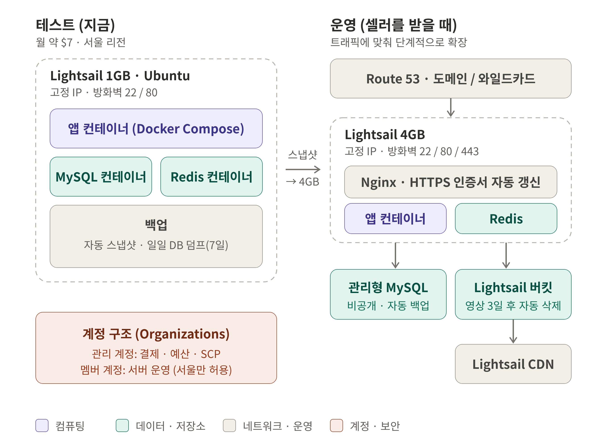

| 단계 | 구성 | 월 비용 |
|---|---|---|
| **테스트** | Lightsail 1GB 한 대 + Docker Compose (앱 · MySQL · Redis 컨테이너) | 약 $7 |
| **운영** | Lightsail 4GB + Lightsail 관리형 MySQL + 버킷 · CDN + Route 53 | 트래픽에 따라 |

### 설계하면서 고민한 것

- **ECS · RDS · ElastiCache로 바로 가지 않은 이유**: 사용자가 없는 초기에도 로드밸런서, NAT, 관리형 DB 고정비가 계속 나온다. 처음에는 Lightsail 월 정액으로 비용을 묶었다.
- **1GB → 4GB 확장**: Lightsail은 스냅샷으로 더 큰 플랜에 복원할 수 있다. 1GB로 시작해도 처음부터 다시 만들 필요가 없다.
- **저장 비용**: 생성 파일(영상)은 버킷에 두고 **3일 뒤 자동 삭제**한다. 오래 쌓이지 않게 한다.
- **1GB 서버 메모리 한계**: MySQL 버퍼와 Redis 메모리를 작게 잡고 스왑 2GB를 둔다. 빌드는 서버가 아닌 외부에서 하고 서버는 완성된 이미지만 받는다.
- **백업**: 테스트 단계는 Lightsail 자동 스냅샷과 일일 DB 덤프(7일 보관)로 한다. 운영 단계는 관리형 MySQL 자동 백업으로 옮긴다.

---

## 1. 새 AWS 계정의 "프로젝트" 구조와 시드니 리전 고정

새로 만든 AWS 계정은 예전 콘솔과 달리 **AWS 설정(settings.aws.com)의 "프로젝트"** 단위로 관리되는 구조였다.
무료 플랜에 크레딧이 주어지고, 프로젝트를 만들면 그 안에 AWS 계정이 하나 생긴다.

첫 프로젝트로 Lightsail에 들어가 보니 리전이 **시드니(ap-southeast-2)**로 잡혀 있었다.

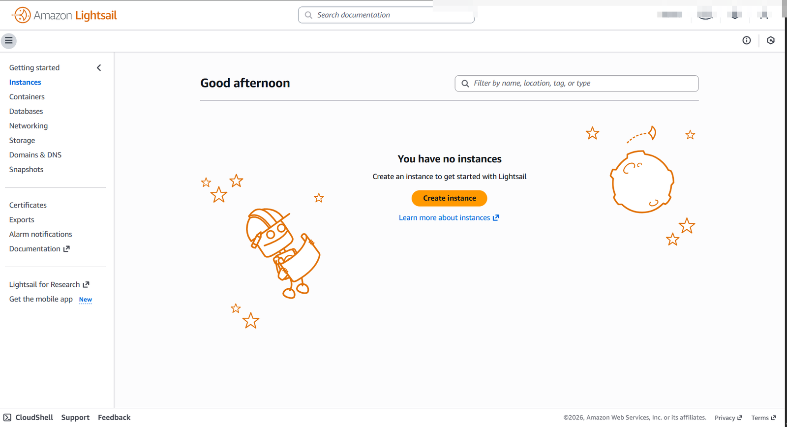

인스턴스 생성 화면은 열렸다. 하지만 대상 사용자가 국내라서 지연 시간을 생각하면 서울 리전이 필요했다.

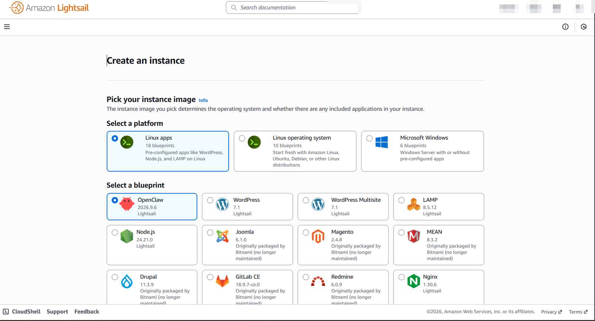

---

## 2. 트러블슈팅: 프로젝트를 실수로 닫음

리전을 바꾸는 방법을 찾다가 AWS 설정 화면에서 프로젝트를 **Close** 해버렸다.
그 뒤로 콘솔에 들어가면 `This project is currently inaccessible`만 떴다.

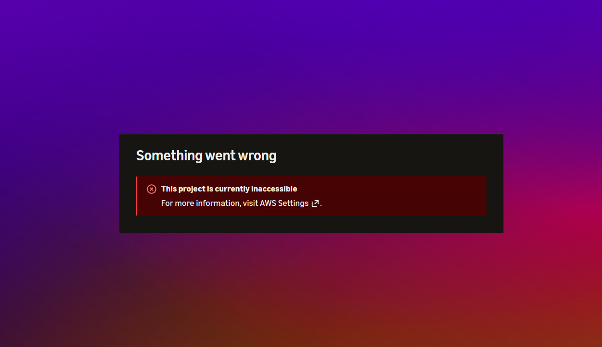

프로젝트 상태도 `Closed`로 바뀌어 있었다.

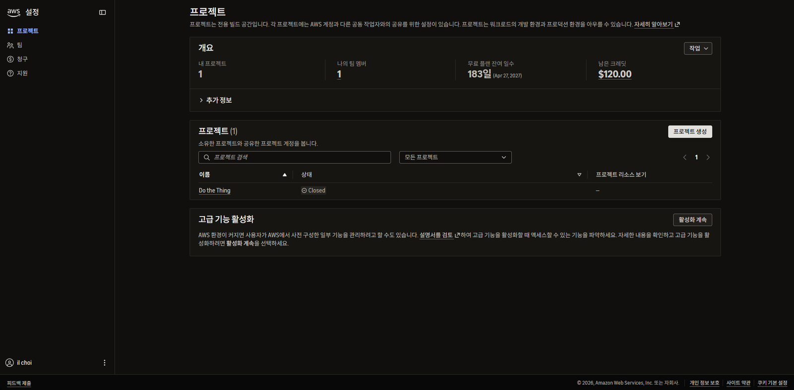

### 대응

- **지원 케이스 두 건**을 열었다. 하나는 콘솔 로그인 불가, 다른 하나는 프로젝트 재오픈 요청이다. Basic Support는 24시간 이내 응답이다.

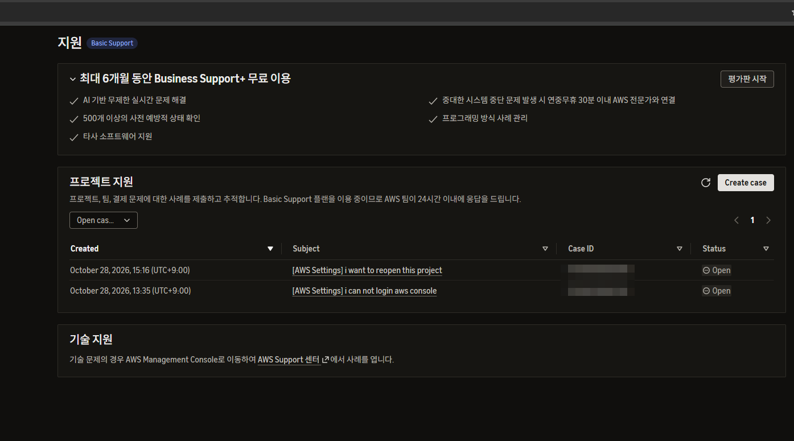

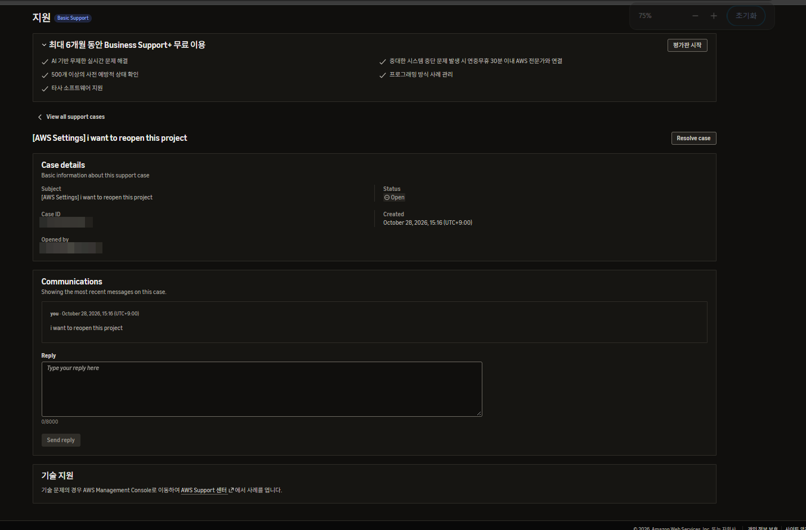

- 답변을 기다리는 동안 작업이 멈추지 않도록 **새 프로젝트를 만들어** 진행했다. 크레딧은 프로젝트가 아니라 상위 계정 단위라 새 프로젝트에서도 그대로 쓸 수 있었다.

**배운 점**: 프로젝트 Close는 휴지통이 아니라 **계정 폐쇄 절차의 시작**이다. 정리가 필요하면 리소스 단위로 지우고, 계정 단위 작업은 마지막에 신중하게 한다.

---

## 3. 트러블슈팅: 서울 리전에서 403

새 프로젝트도 시드니 리전으로 만들어졌다. 그 리전에서는 인스턴스 생성 화면이 정상으로 열렸다.

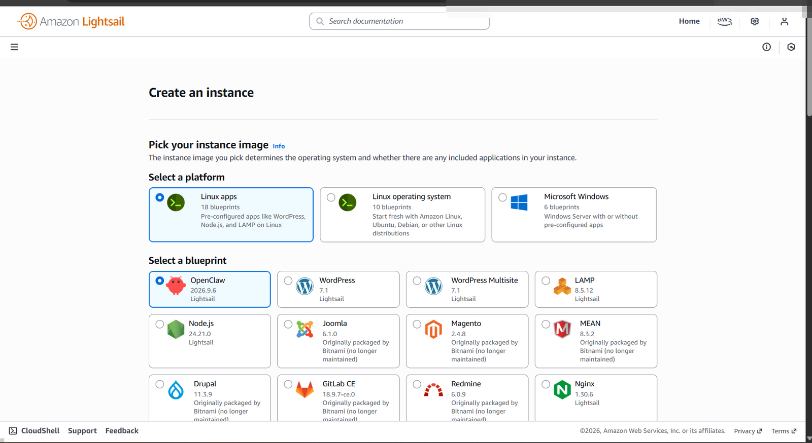

리전을 서울로 바꾸자 Lightsail 조회 API가 전부 거부됐다.

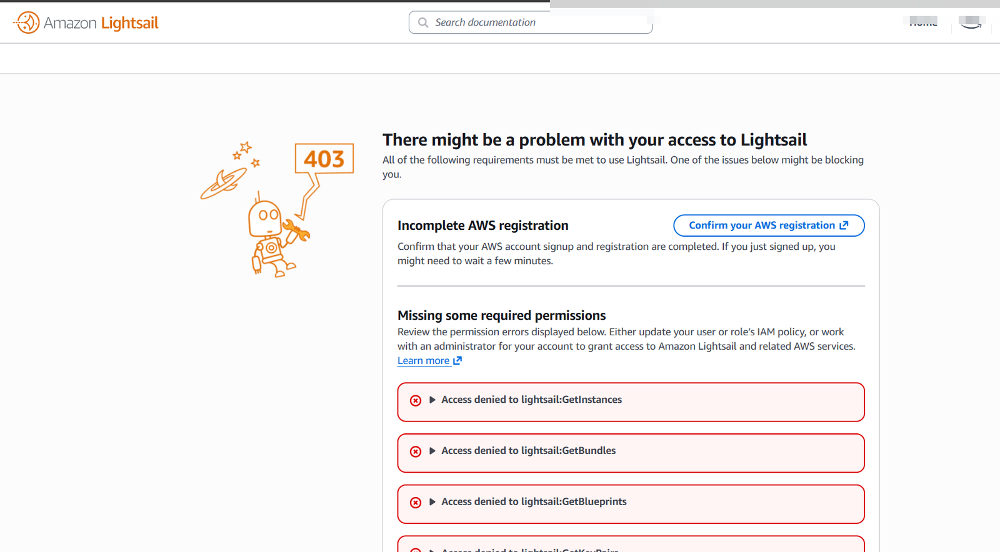

```
Access denied to lightsail:GetInstances
Access denied to lightsail:GetBundles
Access denied to lightsail:GetBlueprints
Access denied to lightsail:GetRegions
Access denied to lightsail:GetKeyPairs
```

### 원인 분석

처음에는 IAM 권한 문제로 보였다. 하지만 로그인한 역할은 `AccountFullAccessRole`이었다. 권한이 부족한 역할이 아니었다.

AWS 문서(*SCPs and RCPs for projects*)를 보고 원인을 찾았다. **프로젝트 계정에는 AWS가 관리하는 서비스 제어 정책(SCP)이 붙어 있다.** 그중 `RegionFloor` 문이 리전을 제한하고 있었다.

| 리전 | 허용 여부 |
|---|---|
| us-east-1, us-west-2 | 정해진 서비스만 허용 |
| 프로젝트를 만들 때 고른 리전 (시드니) | 허용 |
| **그 외 모든 리전 (서울 포함)** | Bedrock 추론 API만 빼고 **전부 거부** |

- SCP는 IAM 권한보다 **위에서** 평가된다. 역할에 전체 권한이 있어도 SCP에서 막히면 거부된다.
- 프로젝트용 SCP는 **AWS가 관리해서 직접 수정할 수 없다.** 고치려면 계정을 **고급 기능(Advanced features)**으로 전환해야 한다.

---

## 4. 고급 기능 활성화

되돌릴 수 없는 작업이라 먼저 문서로 영향 범위를 확인했다.

| 항목 | 전환 후 |
|---|---|
| 계정 구조 | AWS Organizations 기반으로 바뀜. **관리 계정**이 새로 생기고 기존 프로젝트는 **멤버 계정**이 됨 |
| SCP | 결제 · 계정 관리 차단 정책 제거, 리전 정책은 **직접 수정 가능** |
| 지출 한도 | **제거되고 다시 만들 수 없음** → AWS Budgets로 대체 |
| 되돌리기 | 불가 |

지출 한도가 사라지는 것이 가장 큰 위험이었다. 테스트 비용이 월 $7 수준이고, Budgets 알림으로 대신 막을 수 있다고 판단해 진행했다.

### 트러블슈팅: 관리 계정 이메일 오류

활성화 3단계에서 관리 계정 이메일을 인증까지 마쳤는데 마지막에 오류가 났다.

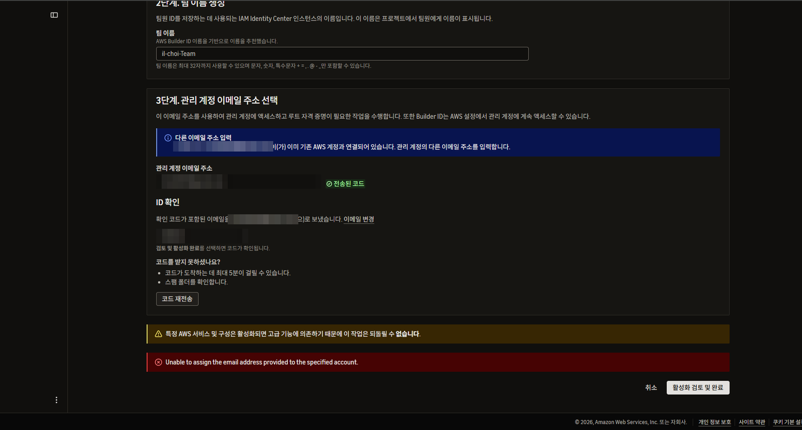

```
Unable to assign the email address provided to the specified account.
```

- **원인**: 관리 계정은 루트 사용자 이메일이 따로 필요하다. 입력한 이메일은 이미 다른 AWS 계정의 루트 이메일로 쓰이고 있었다.
- **해결**: 새 메일 계정 대신 **Gmail의 `+` 별칭**(예: `name+aws-mgmt@gmail.com`)을 썼다. 같은 메일함으로 받지만 AWS에서는 다른 주소로 인식한다.

### 전환 결과: 계정 구조

활성화 후에는 로그인할 때 계정을 고른다.

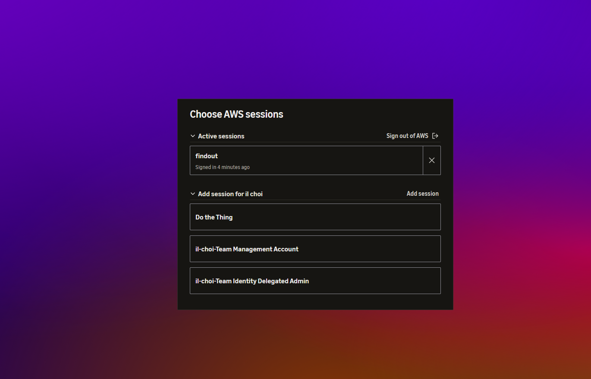

| 계정 | 역할 | 여기서 하는 일 |
|---|---|---|
| 프로젝트 계정 (`findout`) | 멤버 계정 | **서버(Lightsail) 운영** |
| 처음 만든 프로젝트 계정 | 멤버 계정 | 사용 안 함 |
| Management Account | 관리 계정 | 결제 · 예산 · SCP · 접근 권한 관리만 |
| Identity Delegated Admin | AWS가 자동 생성한 위임 관리자 계정 | IAM Identity Center 관리 (us-east-1) |

**워크로드 계정과 관리 계정을 나누는** AWS 권장 구조가 만들어졌다. 관리 계정에는 서버를 만들지 않는다.

---

## 5. 트러블슈팅: 전환 후에도 서울에서 403

멤버 계정으로 들어가 서울 리전을 열었지만 같은 403이 그대로 났다.

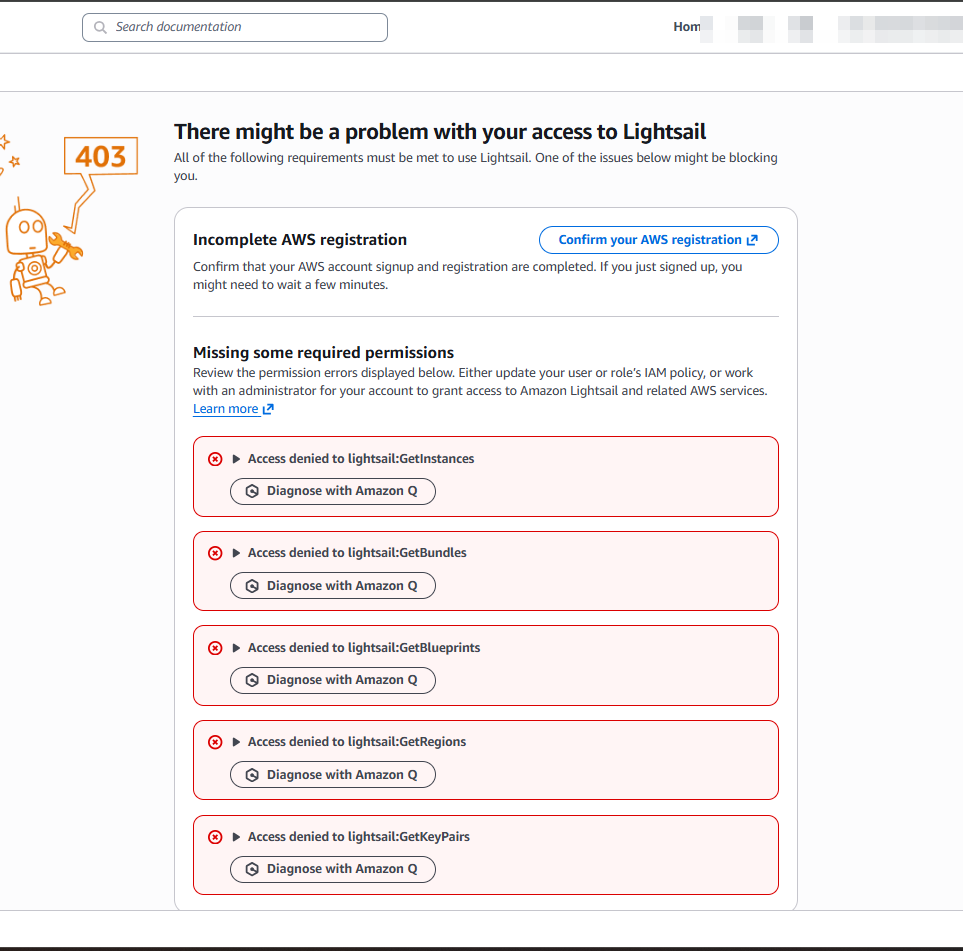

- **원인**: 고급 기능은 SCP를 **고칠 수 있게** 해 줄 뿐이다. 기존 리전 제한 정책은 **그대로 붙어 있다.**
- **해결**: 관리 계정 → **AWS Organizations → 정책 → 서비스 제어 정책**에서 멤버 계정에 연결된 리전 정책을 열었다. `RegionFloor`의 허용 리전 목록에 서울이 없었다.

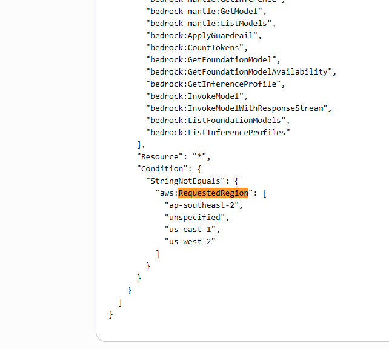

허용 목록에 `ap-northeast-2`를 추가했다.

```diff
 "Condition": {
   "StringNotEquals": {
     "aws:RequestedRegion": [
       "ap-southeast-2",
       "unspecified",
       "us-east-1",
-      "us-west-2"
+      "us-west-2",
+      "ap-northeast-2"
     ]
   }
 }
```

- 같은 정책에 있는 `us-east-1`, `us-west-2` 전용 문은 그 리전에서 쓸 수 있는 서비스 목록이다. 건드리지 않았다.
- 정책을 통째로 떼지 않고 **서울만 추가**했다. 쓰지 않는 리전에서 실수로 리소스가 만들어지는 것은 계속 막는다.

---

## 다음 할 일

- [ ] 서울 리전 Lightsail 접근 확인
- [ ] 관리 계정에서 **AWS Budgets** 월 예산 알림 설정 (지출 한도 대체)
- [ ] Lightsail 1GB 인스턴스 생성 · 고정 IP · 방화벽 22/80
- [ ] 서버 초기 설정 (Docker, 스왑, 자동 스냅샷, DB 백업 cron)

## 배운 점

- **SCP는 IAM보다 위에 있다.** `Access denied`가 나면 IAM 정책만 보지 말고 조직 정책(SCP)부터 확인한다.
- **되돌릴 수 없는 작업은 문서로 영향 범위를 먼저 확인한다.** 지출 한도가 제거된다는 걸 미리 알아서 Budgets로 대비할 수 있었다.
- **권한은 필요한 만큼만 연다.** 리전 제한을 없애지 않고 필요한 리전 하나만 추가했다.

## 참고

- [SCPs and RCPs for projects – AWS Account Management](https://docs.aws.amazon.com/accounts/latest/reference/scps-and-rcps-for-projects.html)
- [Activate advanced AWS features – AWS Account Management](https://docs.aws.amazon.com/accounts/latest/reference/activate-advanced-features.html)
- [Signing in to multiple accounts – AWS Management Console](https://docs.aws.amazon.com/awsconsolehelpdocs/latest/gsg/multisession.html)
